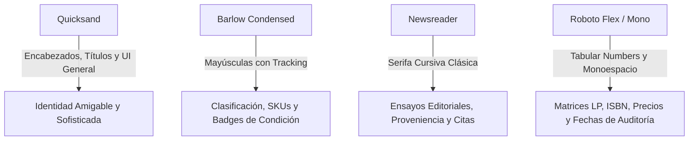

# 🏛️ ARCHIVUM · Guía Maestra del Sistema de Diseño y Estilos UI/UX

> **Sistema de Gestión de Tienda e Inventario de Coleccionables**  
> *Libros Raros y Primeras Ediciones · Discos de Vinilo Históricos · Memorabilia & Documentos Autenticados*  
> Ubicación de recursos de diseño: [`DOC/stitch_sistema_inventario_coleccionables`](file:///c:/Users/quija/sistema-de-gestion-de-tienda-e-inventario/DOC/stitch_sistema_inventario_coleccionables)

---

## 📋 Tabla de Contenidos
1. [Visión General y Filosofía de Marca](#-visión-general-y-filosofía-de-marca)
2. [Estructura de la Carpeta DOC](#-estructura-de-la-carpeta-doc)
3. [Variantes de Diseño Documentadas](#-variantes-de-diseño-documentadas)
4. [Paleta Cromática y Tokens de Color](#-paleta-cromática-y-tokens-de-color)
5. [Sistema Tipográfico (4-Font Pairing)](#-sistema-tipográfico-4-font-pairing)
6. [Espaciado, Rejilla y Geometría](#-espaciado-rejilla-y-geometría)
7. [Elevación, Sombras y Profundidad](#-elevación-sombras-y-profundidad)
8. [Catálogo de Componentes Clave](#-catálogo-de-componentes-clave)
9. [Pantallas y Plantillas Prototipadas](#-pantallas-y-plantillas-prototipadas)
10. [Guía de Integración Técnica en Laravel & Tailwind CSS](#-guía-de-integración-técnica-en-laravel--tailwind-css)

---

## 🏛️ Visión General y Filosofía de Marca

El sistema visual **ARCHIVUM** encarna una estética denominada **Archival Editorial Luxury** (Lujo Editorial Archivístico). Diseñado para libreros anticuarios, curadores de vinilo, tasadores y coleccionistas de alta gama, el diseño fusiona el rigor metódico de un archivo institucional con la velocidad y elegancia de una plataforma de comercio digital contemporánea.

### Principios Fundamentales:
* **Luminosidad Atmosférica:** En lugar de fondos clínicos (#FFFFFF puro y estridente) o negros oscuros sin matiz, las interfaces respiran mediante veladuras de lino alabastro, lavanda sutil y glicina (*wisteria*).
* **Contraste de Museo:** La tinta principal abandona el gris carbón plano en favor de profundidades violeta imperial (`#24005B` / `#10002B`), otorgando autoridad y calidez tipográfica.
* **Prohibición de Emojis e Informalidades:** Cero emoticonos o ilustraciones infantiles. Toda la iconografía utiliza glifos vectoriales monolineales puros y geométricos (**Google Material Symbols Outlined** a 1.5px / 2px de trazo).
* **Doble Función:** Equilibrio entre alta densidad de datos (códigos de matriz de prensado, ISBN, SKUs, estanterías, bitácoras) y presentación editorial de obras de arte (portadas de vinilos LP, encuadernaciones históricas y sellos notariales).

---

## 📁 Estructura de la Carpeta DOC

Dentro de [`DOC/stitch_sistema_inventario_coleccionables/`](file:///c:/Users/quija/sistema-de-gestion-de-tienda-e-inventario/DOC/stitch_sistema_inventario_coleccionables), el proyecto cuenta con especificaciones de diseño y 11 pantallas prototipadas funcionales:

```text
DOC/
└── stitch_sistema_inventario_coleccionables/
    ├── README.md                                                     # Guía del sistema de diseño
    ├── archival_amethyst/                                            # Variante 1: Arquetipo institucional ortogonal (0px radius)
    │   └── DESIGN.md
    ├── archivum_amethyst_editorial/                                  # Variante 2 (PRINCIPAL / IMPLEMENTADA): Curaduría editorial
    │   └── DESIGN.md
    ├── bibliotheca_vinyl_archive/                                    # Variante 3: Dark Mode y alta densidad para vinilos
    │   └── DESIGN.md
    │
    └── [Prototipos de Pantalla con código HTML y Capturas PNG]:
        ├── dashboard_del_administrador_morado_claro/                 # Panel de KPIs, ventas, sucursales y bitácora
        ├── inventario_y_cat_logo_unificado_morado_claro/             # Tabla maestra unificada con filtros multifaceta
        ├── cat_logo_de_libros_raros_primeras_ediciones_morado_claro/ # Fichas de incunables, primeras ediciones y encuadernaciones
        ├── cat_logo_de_discos_vinilos_hist_ricos_morado_claro/       # Fichas de LPs, RPM, matrix runout y gradación de audio
        ├── cat_logo_de_coleccionables_memorabilia_morado_claro/      # Certificados de autenticidad y línea de procedencia
        ├── tienda_p_blica_carrito_de_compras_morado_claro/           # Carrito e-commerce con contador de reserva temporal
        ├── proceso_de_pago_checkout_morado_claro/                    # Pasarela en 3 pasos (envío, pago, verificación)
        ├── confirmaci_n_de_compra_y_factura_morado_claro/            # Comprobante fiscal y factura formal imprimible
        ├── mi_cuenta_perfil_de_coleccionista_morado_claro/           # Historial, wishlist de piezas raras y datos del coleccionista
        ├── portal_de_autenticaci_n_registro_morado_claro/            # Login, registro con credenciales seguras
        └── recuperaci_n_de_contrase_a_token_morado_claro/            # Verificación por token de 6 dígitos
```

---

## 🎨 Variantes de Diseño Documentadas

El repositorio documenta tres iteraciones arquitectónicas de estilo:

| Característica | 1. Archival Amethyst | 2. Archivum Amethyst Editorial *(Elegida)* | 3. Bibliotheca & Vinyl Archive |
| :--- | :--- | :--- | :--- |
| **Enfoque** | Institucional rígido / Archivo físico | **Curaduría de lujo / E-commerce híbrido** | Modo oscuro / Alta densidad de bodega |
| **Bordes (`radius`)** | Estricto `0px` (esquinas rectas) | **Suave y balanceado: `0.25rem` a `0.75rem`** | Mixto: `0.5rem` a `1.5rem` con pills |
| **Fondo Base** | Lino Alabastro `#fbfaff` | **Amatista Claro `#fef7ff` / `#fbf7fe`** | Obsidiana Profunda `#10002B` / `#1a0935` |
| **Color Primario** | Amatista Real `#3c096c` | **Violeta Amatista Eléctrico `#630ed4` / `#7c3aed`** | Lavanda / Malva `#C77DFF` / `#7B2CBF` |
| **Tipografías** | Quicksand + Roboto Flex | **Quicksand + Barlow Condensed + Newsreader + Roboto Flex** | Quicksand + Newsreader + Hanken Grotesk + Roboto |

> 💡 **Nota de Implementación:** Las 11 pantallas HTML de la carpeta DOC adoptan formalmente la variante **Archivum Amethyst Editorial** (`_morado_claro`), configurando Tailwind CSS con tokens Material Design 3.

---

## 🟣 Paleta Cromática y Tokens de Color

### 1. Colores Primarios y de Marca
| Token | Hex | Nombre Descriptivo | Uso Recomendado |
| :--- | :--- | :--- | :--- |
| `primary` | `#630ed4` | Imperial Electric Violet | Acciones clave, botones principales activos, logos |
| `primary-container` | `#7c3aed` | Vibrant Amethyst | Fondos de botones activos, pestañas seleccionadas |
| `on-primary` | `#ffffff` | Pure White | Texto sobre `primary` y `primary-container` |
| `on-primary-container` | `#ede0ff` | Pale Lilac Tint | Texto secundario sobre contenedores violeta |
| `primary-fixed-dim` | `#d2bbff` | Soft Amethyst | Halos de selección y rings de enfoque |

### 2. Colores Secundarios y Terciarios
| Token | Hex | Nombre Descriptivo | Uso Recomendado |
| :--- | :--- | :--- | :--- |
| `secondary` | `#625595` | Muted Wisteria | Subtítulos, identificadores de versión, estados neutros |
| `secondary-container` | `#c6b7ff` | Lavender Glow | Badges de categorías y acentos secundarios |
| `on-secondary-container` | `#524584` | Deep Lavender | Texto sobre fondos `secondary-container` |
| `tertiary` | `#7300c6` | Royal Amethyst | Sellos de autenticidad y certificaciones notariales |
| `tertiary-container` | `#8f2de6` | Vivid Violet | Indicadores de coleccionable destacado |

### 3. Superficies, Lienzos y Fondos Graduados
| Token | Hex | Función Arquitectónica |
| :--- | :--- | :--- |
| `background` | `#fef7ff` / `#fbf7fe` | Lienzo principal del body y páginas completas |
| `surface-container-lowest` | `#ffffff` | Tarjetas de inspección elevadas, sidebar maestro y barra superior |
| `surface-container-low` | `#f9f1ff` | Fondos de inputs, buscadores inactivos y bandejas de KPIs |
| `surface-container` | `#f4eaff` | Paneles laterales de filtros, cajones deslizantes |
| `surface-container-high` | `#efe4ff` | Pestañas inactivas, filas en hover |
| `surface-container-highest`| `#eaddff` | Divisores tonales y separadores sutiles |

### 4. Tintas y Tipografía
| Token | Hex | Función de Lectura |
| :--- | :--- | :--- |
| `on-surface` | `#24005b` | Tinta de máximo contraste para títulos, precios y valores KPI |
| `on-surface-variant` | `#4a4455` | Texto corrido de lectura, descripciones y notas |
| `outline` | `#7b7487` | Iconografía secundaria, textos de ayuda y placeholders |
| `outline-variant` | `#ccc3d8` / `purple-200/70` | Bordes perimetrales de tarjetas, tablas e inputs |

### 5. Semántica y Estados Operativos
* **En Stock / Sincronizado:** Fondo `#d1fae5` (Emerald-100), Texto `#065f46` (Emerald-800), Acento `#06d6a0`.
* **Bajo Stock / Advertencia:** Fondo `#fef3c7` (Amber-100), Texto `#92400e` (Amber-800), Acento `#ffb703`.
* **Agotado / Alerta Crítica:** `error: #ba1a1a`, `error-container: #ffdad6`, `on-error: #ffffff`.
* **En Tránsito / Reserva:** Fondo `#e0f2fe` (Sky-100), Texto `#0369a1` (Sky-800), Acento `#4cc9f0`.

---

## 🔤 Sistema Tipográfico (4-Font Pairing)

El sistema emplea cuatro familias tipográficas especializadas para reproducir la sensación de un catálogo bibliográfico de archivo:



### Escala de Tipografías y Clases Utilitarias

| Token / Clase | Familia | Tamaño | Interlineado | Peso | Espaciado (`tracking`) | Aplicación |
| :--- | :--- | :--- | :--- | :--- | :--- | :--- |
| `display-lg` | Quicksand | 48px | 56px | 600 (SemiBold) | `-0.02em` | Héroes e intros de colección |
| `headline-lg` | Quicksand | 32px | 40px | 600-700 | `-0.01em` | Títulos principales de página (H1) |
| `headline-md` | Quicksand | 24px | 32px | 500-600 | Normal | Títulos de sección y modales |
| `headline-sm` | Quicksand | 20px | 28px | 500 | Normal | Títulos de tarjetas y widgets |
| `title-editorial` | Newsreader | 18px | 26px | 500 Italic | Normal | Subtítulos de curador y reseñas de época |
| `title-md` | Quicksand | 16px | 24px | 600 | Normal | Nombre de artículo en listados |
| `body-lg` | Quicksand | 16px | 26px | 400 | Normal | Párrafos introductorios |
| `body-md` | Quicksand | 14px | 22px | 400 | Normal | Texto general de la aplicación |
| `body-sm` | Quicksand | 12px | 18px | 400 | Normal | Notas al pie e instrucciones |
| `label-lg` | Barlow Condensed | 14px | 18px | 600 | `0.08em` | Botones principales y tabs en mayúsculas |
| `label-md` | Barlow Condensed | 12px | 16px | 600 | `0.10em` | Encabezados de tablas y filtros |
| `label-sm` | Barlow Condensed | 10px | 14px | 500 | `0.12em` | Badges de condición (MINT, VG+, FOIL) |
| `label-code` | Roboto Flex | 11px | 14px | 600 | `0.06em` | IDs de sesión, códigos de estante |
| `tabular-data` | Roboto Flex | 13px | 18px | 500 | `0.01em` | Cantidades, monedas MXN/USD, porcentajes |

---

## 📐 Espaciado, Rejilla y Geometría

### 1. Escala de Espaciado (Basada en múltiplos de 4px / 8px)
* `space-xs`: `0.25rem` (4px) — Distancia entre chips y etiquetas.
* `space-sm`: `0.5rem` (8px) — Relleno interno de botones pequeños y brechas entre iconos/textos.
* `space-md`: `1rem` (16px) — Padding estándar de tarjetas y márgenes en móvil.
* `space-lg`: `1.5rem` (24px) — Medianiles de rejilla (`gutter`), padding en secciones.
* `space-xl`: `2.5rem` (40px) — Separaciones entre grandes bloques y cabeceras.
* `margin`: `3rem` (48px) — Margen exterior en pantallas de escritorio.

### 2. Geometría y Radio de Esquinas (`border-radius`)
* `DEFAULT` / `sm`: `0.25rem` (4px) — Chips compactos de código y checkboxes.
* `lg`: `0.5rem` (8px) — Botones, cajas de texto (`input`), selects y tarjetas de KPI.
* `xl`: `0.75rem` (12px) — Paneles maestros, marcos de tarjetas de producto y diálogos.
* `full`: `9999px` — Pastillas de estado (*status pills*), avatares y conmutadores.

---

## 🧊 Elevación, Sombras y Profundidad

Para mantener el carácter editorial y limpio, el sistema **rechaza las sombras difusas y pesadas**. En su lugar, aplica:
1. **Líneas de Cabello de Alta Precisión (*Hairline Borders*):**  
   Bordes de `1px` con color violeta transparente: `border border-purple-200/70` o `border border-purple-100`.
2. **Capas Tonales Graduadas:**  
   La profundidad se percibe superponiendo capas: Fondo (`#fef7ff`) ➔ Panel (`#f9f1ff`) ➔ Tarjeta activa (`#ffffff`).
3. **Micro-Sombra con Tinte Violeta Imperial:**
   ```css
   /* Sombra suave de tarjeta */
   box-shadow: 0 1px 3px 0 rgba(36, 0, 91, 0.05), 0 1px 2px -1px rgba(36, 0, 91, 0.05);
   /* Sombra de menú flotante / elevación */
   box-shadow: 0 10px 15px -3px rgba(36, 0, 91, 0.08), 0 4px 6px -4px rgba(36, 0, 91, 0.04);
   ```
4. **Cristal de Archivo (*Archival Glass*):**  
   Encabezados fijos y barras de herramientas utilizan translucidez:  
   `bg-surface-container-lowest/95 backdrop-blur-md border-b border-purple-200/70`.

---

## 🧩 Catálogo de Componentes Clave

### 1. Botones (`Buttons`)
* **Primario:**
  ```html
  <button class="bg-primary-container text-white px-space-md py-2 rounded-lg font-label-md uppercase tracking-wider hover:bg-primary shadow-sm transition-colors">
    Registrar Adquisición
  </button>
  ```
* **Secundario / Contorno:**
  ```html
  <button class="bg-surface-container-low text-on-surface border border-purple-200/80 px-space-md py-2 rounded-lg font-label-md uppercase tracking-wider hover:bg-surface-container transition-colors">
    Descargar Ficha Técnica
  </button>
  ```
* **Botón de Icono:**
  ```html
  <button class="p-2 rounded-lg bg-surface-container-low hover:bg-surface-container border border-purple-200/60 text-on-surface-variant hover:text-on-surface transition-colors">
    <span class="material-symbols-outlined text-[20px]">tune</span>
  </button>
  ```

### 2. Badges de Condición de Colección (*Preservation & Grading Tags*)
* **Mint / Impecable:**  
  `<span class="px-2.5 py-0.5 rounded-full bg-emerald-100 text-emerald-800 font-label-sm uppercase tracking-wider font-semibold">MINT / IMPECABLE</span>`
* **Primera Edición / Rareza:**  
  `<span class="px-2.5 py-0.5 rounded-full bg-primary-container/15 text-primary border border-primary/20 font-label-sm uppercase tracking-wider font-semibold">1ST EDITION · 1968</span>`
* **Sello de Autenticidad Verificada:**  
  `<span class="px-2 py-0.5 rounded-full bg-tertiary text-white font-label-code flex items-center gap-1 font-semibold"><span class="material-symbols-outlined text-[13px]">verified</span> AUTENTICADO COA</span>`

### 3. Inputs de Búsqueda y Filtros
```html
<div class="relative w-full">
  <span class="material-symbols-outlined absolute left-3 top-1/2 -translate-y-1/2 text-outline text-[18px]">search</span>
  <input type="text"
    placeholder="Buscar por SKU, ISBN, catálogo vinilo, título o autor..."
    class="w-full bg-surface-container-low pl-10 pr-space-md py-2 rounded-lg border border-purple-200/80 font-body-sm text-on-surface placeholder:text-outline focus:outline-none focus:border-primary focus:bg-white transition-colors" />
</div>
```

### 4. Tarjetas de Métricas KPI
Estructuradas en 3 niveles:
1. Micro-cabecera en `font-label-code` con el nombre de tabla técnica (`pedidos_table & pagos_table`) e icono temático.
2. Cifra principal en `font-headline-lg text-primary font-bold` con denominación de moneda.
3. Indicador de tendencia con badge verde/rojo y resumen de valor promedio.

### 5. Tablas Maestras de Inventario
* Encabezados superiores con borde inferior reforzado en `border-purple-200`.
* Celdas de identificador técnico y fechas en clase `font-tabular-data` o `font-label-code`.
* Estados de stock destacados mediante puntos coloreados con anillo de halo (`ring-2 ring-emerald-100`).

---

## 🖥️ Pantallas y Plantillas Prototipadas

Las 11 pantallas prototipadas se encuentran completamente documentadas en código HTML interactivo dentro de [`DOC/stitch_sistema_inventario_coleccionables/`](file:///c:/Users/quija/sistema-de-gestion-de-tienda-e-inventario/DOC/stitch_sistema_inventario_coleccionables):

| Carpeta de Pantalla | Propósito y Contenido Principal |
| :--- | :--- |
| [`dashboard_del_administrador_morado_claro`](file:///c:/Users/quija/sistema-de-gestion-de-tienda-e-inventario/DOC/stitch_sistema_inventario_coleccionables/dashboard_del_administrador_morado_claro) | Panel administrativo principal: 4 KPIs maestros, selector de sucursales, estado de sincronización y tabla de movimientos recientes. |
| [`inventario_y_cat_logo_unificado_morado_claro`](file:///c:/Users/quija/sistema-de-gestion-de-tienda-e-inventario/DOC/stitch_sistema_inventario_coleccionables/inventario_y_cat_logo_unificado_morado_claro) | Vista unificada de inventario con filtros por categoría (Libros, Discos, Memorabilia), estantería, estados de stock y edición rápida. |
| [`cat_logo_de_libros_raros_primeras_ediciones_morado_claro`](file:///c:/Users/quija/sistema-de-gestion-de-tienda-e-inventario/DOC/stitch_sistema_inventario_coleccionables/cat_logo_de_libros_raros_primeras_ediciones_morado_claro) | Catálogo especializado en libros antiguos con visualización de encuadernación, editorial, año de impresión e ISBN histórico. |
| [`cat_logo_de_discos_vinilos_hist_ricos_morado_claro`](file:///c:/Users/quija/sistema-de-gestion-de-tienda-e-inventario/DOC/stitch_sistema_inventario_coleccionables/cat_logo_de_discos_vinilos_hist_ricos_morado_claro) | Catálogo de vinilos con ficha de matriz, RPM (33⅓, 45, 78), prensado, sello discográfico y gradación Goldmine (Mint, VG+, etc.). |
| [`cat_logo_de_coleccionables_memorabilia_morado_claro`](file:///c:/Users/quija/sistema-de-gestion-de-tienda-e-inventario/DOC/stitch_sistema_inventario_coleccionables/cat_logo_de_coleccionables_memorabilia_morado_claro) | Galería de memorabilia histórica con visualizador de firmas, hologramas de autenticidad y línea de tiempo de custodia. |
| [`tienda_p_blica_carrito_de_compras_morado_claro`](file:///c:/Users/quija/sistema-de-gestion-de-tienda-e-inventario/DOC/stitch_sistema_inventario_coleccionables/tienda_p_blica_carrito_de_compras_morado_claro) | Carrito de compras con bloqueo temporal de reserva (countdown de 15 min para piezas únicas) y desglose de aranceles/envío seguro. |
| [`proceso_de_pago_checkout_morado_claro`](file:///c:/Users/quija/sistema-de-gestion-de-tienda-e-inventario/DOC/stitch_sistema_inventario_coleccionables/proceso_de_pago_checkout_morado_claro) | Checkout en tres pasos con validación de dirección asegurada, métodos de pago y resumen de lote. |
| [`confirmaci_n_de_compra_y_factura_morado_claro`](file:///c:/Users/quija/sistema-de-gestion-de-tienda-e-inventario/DOC/stitch_sistema_inventario_coleccionables/confirmaci_n_de_compra_y_factura_morado_claro) | Certificado digital de compra, factura con validez fiscal y botón de exportación a PDF para archivo del cliente. |
| [`mi_cuenta_perfil_de_coleccionista_morado_claro`](file:///c:/Users/quija/sistema-de-gestion-de-tienda-e-inventario/DOC/stitch_sistema_inventario_coleccionables/mi_cuenta_perfil_de_coleccionista_morado_claro) | Portal de cliente con lista de deseos de rarezas, alertas de disponibilidad por autor/artista y compras previas. |
| [`portal_de_autenticaci_n_registro_morado_claro`](file:///c:/Users/quija/sistema-de-gestion-de-tienda-e-inventario/DOC/stitch_sistema_inventario_coleccionables/portal_de_autenticaci_n_registro_morado_claro) | Formulario de inicio de sesión y registro con validación de seguridad de 2 factores para curadores y clientes. |
| [`recuperaci_n_de_contrase_a_token_morado_claro`](file:///c:/Users/quija/sistema-de-gestion-de-tienda-e-inventario/DOC/stitch_sistema_inventario_coleccionables/recuperaci_n_de_contrase_a_token_morado_claro) | Flujo de recuperación de credenciales mediante código PIN de seguridad de un solo uso. |

---

## ⚙️ Guía de Integración Técnica en Laravel & Tailwind CSS

Para implementar este sistema de diseño directamente en la aplicación Laravel (`resources/css/app.css` y Blade templates):

### 1. Inclusión de Fuentes e Iconos en el `<head>` del Layout Blade
Agrega en `resources/views/layouts/app.blade.php`:

```html
<!-- Fuentes de Google Fonts: Quicksand, Barlow Condensed, Newsreader, Roboto Flex -->
<link rel="preconnect" href="https://fonts.googleapis.com">
<link rel="preconnect" href="https://fonts.gstatic.com" crossorigin>
<link href="https://fonts.googleapis.com/css2?family=Barlow+Condensed:wght@400;500;600;700&family=Newsreader:ital,wght@0,400;0,500;1,400;1,500&family=Quicksand:wght@400;500;600;700&family=Roboto+Flex:wght@400;500;600&display=swap" rel="stylesheet" />

<!-- Google Material Symbols Outlined -->
<link href="https://fonts.googleapis.com/css2?family=Material+Symbols+Outlined:wght,FILL@100..700,0..1&display=swap" rel="stylesheet" />
```

### 2. Configuración en `resources/css/app.css` (Tailwind CSS v4)
Tailwind v4 utiliza variables `@theme` nativas:

```css
@import 'tailwindcss';

@theme {
  /* Familias Tipográficas */
  --font-display: 'Quicksand', sans-serif;
  --font-body: 'Quicksand', sans-serif;
  --font-label: 'Barlow Condensed', sans-serif;
  --font-editorial: 'Newsreader', serif;
  --font-mono: 'Roboto Flex', monospace;

  /* Colores de Marca y Superficie */
  --color-primary: #630ed4;
  --color-primary-container: #7c3aed;
  --color-on-primary: #ffffff;
  --color-on-primary-container: #ede0ff;

  --color-secondary: #625595;
  --color-secondary-container: #c6b7ff;
  --color-on-secondary-container: #524584;

  --color-tertiary: #7300c6;
  --color-tertiary-container: #8f2de6;

  --color-background: #fef7ff;
  --color-surface: #fef7ff;
  --color-surface-container-lowest: #ffffff;
  --color-surface-container-low: #f9f1ff;
  --color-surface-container: #f4eaff;
  --color-surface-container-high: #efe4ff;
  --color-surface-container-highest: #eaddff;

  --color-on-surface: #24005b;
  --color-on-surface-variant: #4a4455;
  --color-outline: #7b7487;
  --color-outline-variant: #ccc3d8;

  --color-error: #ba1a1a;
  --color-error-container: #ffdad6;

  /* Espaciado de Archivo */
  --spacing-space-xs: 0.25rem;
  --spacing-space-sm: 0.5rem;
  --spacing-space-md: 1rem;
  --spacing-space-lg: 1.5rem;
  --spacing-space-xl: 2.5rem;
  --spacing-gutter: 1.5rem;
  --spacing-margin: 3rem;
}

@layer base {
  body {
    background-color: var(--color-background);
    color: var(--color-on-surface);
    font-family: var(--font-body);
    -webkit-font-smoothing: antialiased;
  }
}
```

---

*Documentación compilada automáticamente a partir del análisis técnico y visual de los archivos de especificación y prototipos en `DOC/stitch_sistema_inventario_coleccionables/`.*
